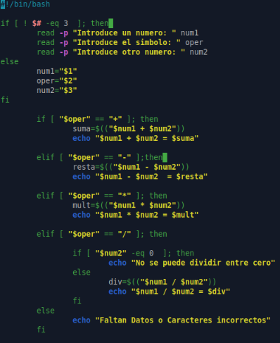
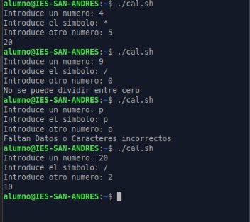
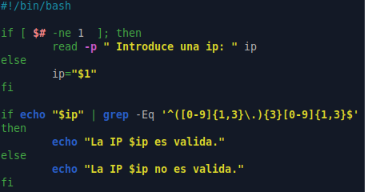
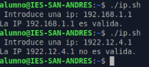
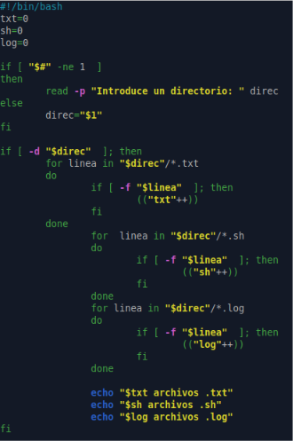
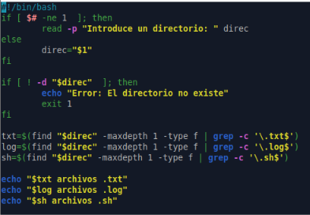
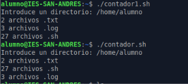

# PR0303: Parámetros en Bash
1. Calculadora básica
Crea un script que funcione como una calculadora de operaciones básicas.

Debe recibir como parámetros:

* Primer número
* Operación (+, -, *, /)
* Segundo número Si no se pasan parámetros, debe solicitar los valores al usuario.
* Debe manejar errores, como división por 0.





2. Validador de direcciones IP
Crea un script que verifique si una dirección IP es válida.


* Debe recibir la dirección IP como parámetro.
* Si no se pasa, debe pedirla al usuario.
* Usa grep para validar el formato X.X.X.X, donde X es un número que tiene entre 1 y 3 dígitos.



``` 

if echo "$ip" | grep -Eq '^([0-9]{1,3}\.){3}[0-9]{1,3}$'

```
Aquí se usa ```grep``` con expresiones regulares avanzadas (```-E```) de forma silenciosa (```-q```, para que no imprima texto en pantalla, solo devuelva si coincide o no). La fórmula ```'^([0-9]{1,3}\.){3}[0-9]{1,3}$'``` se desglosa así:
*  ```^``` y ```$```: Marcan el inicio (^) y el final ($) de la cadena. Esto asegura que toda la línea sea la IP y que no haya texto extra alrededor.
* ```([0-9]{1,3}\.)```: Busca un bloque de números de 1 a 3 dígitos ```([0-9]{1,3})``` seguido de un punto literal (```\.```).
* ```{3}```: Indica que el bloque anterior (número + punto) debe repetirse exactamente 3 veces (por ejemplo: 192. 168. 1.).
* ```[0-9]{1,3}```: Al final, busca un último bloque de números de 1 a 3 dígitos, pero este ya no lleva punto (por ejemplo: ```1```).




3. Contador de archivos por tipo
Crea un script que cuente los archivos con extensión txt, log y sh que hay en dicho directorio.

* Debe recibir el directorio como parámetro (si no se pasara el parámetro lo solicitará por teclado).
* Mostrará cuántos archivos hay de cada extensión (.txt, .sh, .log, etc.).
* Usa find y grep para procesar los datos.
### sin egrep y find

### con egrep y find




4. Backup de un directorio
Descripción:

Crea un script que realice una copia de seguridad de un directorio.

* Debe recibir el directorio origen y el directorio destino como parámetros.
* Si no se pasan, debe solicitarlos.
* Usa el comando tar para generar el backup con la fecha actual en el nombre.

5. Conversor de temperatura (Celsius ⇄ Fahrenheit)
Crea un script que convierta una temperatura entre Celsius y Fahrenheit.

* Debe recibir la temperatura y la unidad como parámetros (C o F).
* Si no se pasan, debe solicitarlos al usuario.

6. Generador de nombres de archivos aleatorios
Crea un script que genere un nombre aleatorio para un archivo.

* Debe aceptar una extensión como parámetro.
* Si no se pasa, debe preguntar al usuario.
* Usa /dev/urandom o date para generar nombres únicos.

7. Script para comparar dos archivos
Crea un script que compare dos archivos y muestre las diferencias.

* Debe recibir los dos archivos como parámetros.
* Si no se pasan, debe solicitarlos.
* Usa diff para comparar y mostrar diferencias resaltadas.

8. Generador de números aleatorios dentro de un rango
Crea un script que genere un número aleatorio entre un mínimo y un máximo.

* Debe recibir los valores mínimo y máximo como parámetros.
* Si no se pasan, debe solicitarlos al usuario.
* Usa $RANDOM para generar el número.