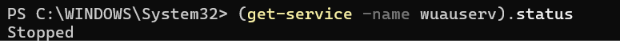
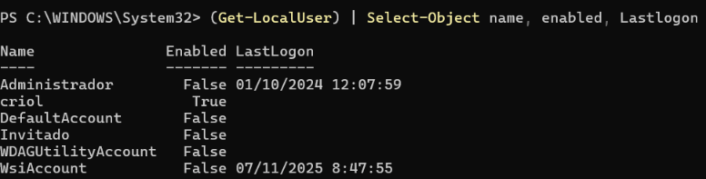
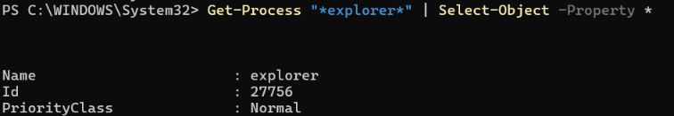
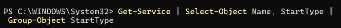
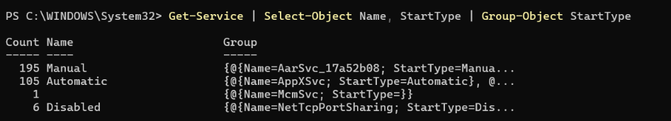
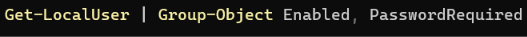
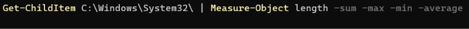
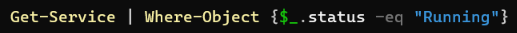
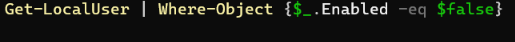
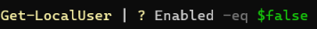

# [INDICE](../index.md)
<br>
<br>

---

# PR0401: Canalización, objetos y formato en Powershell

## Bloque 1: Inspección y selección de objetos ```(Get-Member y Select-Object) ```

1. Descubriendo tipos de objetos: ejecuta el comando que lista los servicios del sistema (Get-Service) y canaliza su salida para averiguar qué tipo de objeto (TypeName) devuelve exactamente.


2. Explorando métodos y propiedades: lista únicamente las propiedades (Properties) que tienen los objetos devueltos por el comando Get-Process. ¿Qué propiedad almacena la ruta del ejecutable o el identificador del proceso (PID)?


3. Acceso directo a propiedades: utilizando la sintaxis de paréntesis y el punto (Comando).Propiedad, muestra por pantalla únicamente el estado (Status) del servicio de Windows Update (wuauserv).



4. Selección de propiedades específicas: muestra un listado de todos los usuarios locales del equipo (Get-LocalUser), pero haz que solo se muestren por pantalla las propiedades Name, Enabled y LastLogon.



5. Inspección completa: muestra absolutamente todas las propiedades y sus valores para el proceso explorer utilizando caracteres comodín.



## Bloque 2: Ordenación, agrupación y medición (Sort, Group, Measure)
1. Ordenación descendente: obtén un listado de todos los procesos actuales del sistema ordenados por su consumo de memoria de trabajo (WS) de mayor a menor.


2. Auditoría de servicios con agrupación: agrupa todos los servicios del sistema (Get-Service) según su tipo de inicio (StartType) para saber de un vistazo cuántos servicios son automáticos, manuales o están deshabilitados.





3. Agrupación por múltiples criterios: agrupa las cuentas de usuario locales (Get-LocalUser) en función de si están habilitadas (Enabled) y si requieren contraseña (PasswordRequired).



4. Cálculo de estadísticas de ficheros: dirígete al directorio C:\Windows\System32 (o indícalo como ruta en Get-ChildItem) y calcula el tamaño (Length) mínimo, máximo y el promedio de los archivos que se encuentran directamente en esa carpeta.



## Bloque 3: Filtrado de objetos (Where-Object)
1. Filtrado básico (Sintaxis moderna): muestra todos los servicios del sistema cuyo estado (Status) sea exactamente Running. Utiliza la sintaxis simplificada (sin llaves ni $_).





2. Filtrado clásico (Scriptblock): muestra todas las cuentas de usuario locales que estén deshabilitadas (Enabled igual a $false) utilizando obligatoriamente la sintaxis de bloque de script ({ $_... }).


<b>ALIAS ?</b>



3. Filtrado con comodines: busca todos los procesos en ejecución cuyo nombre (Name) empiece por la letra ”s” y tenga cualquier cadena detrás.


<b>Where-Object</b>


4. Filtrado numérico: obtén un listado de los procesos cuyo identificador (Id) sea mayor o igual a 5000.


---

# [INDICE](../index.md)
